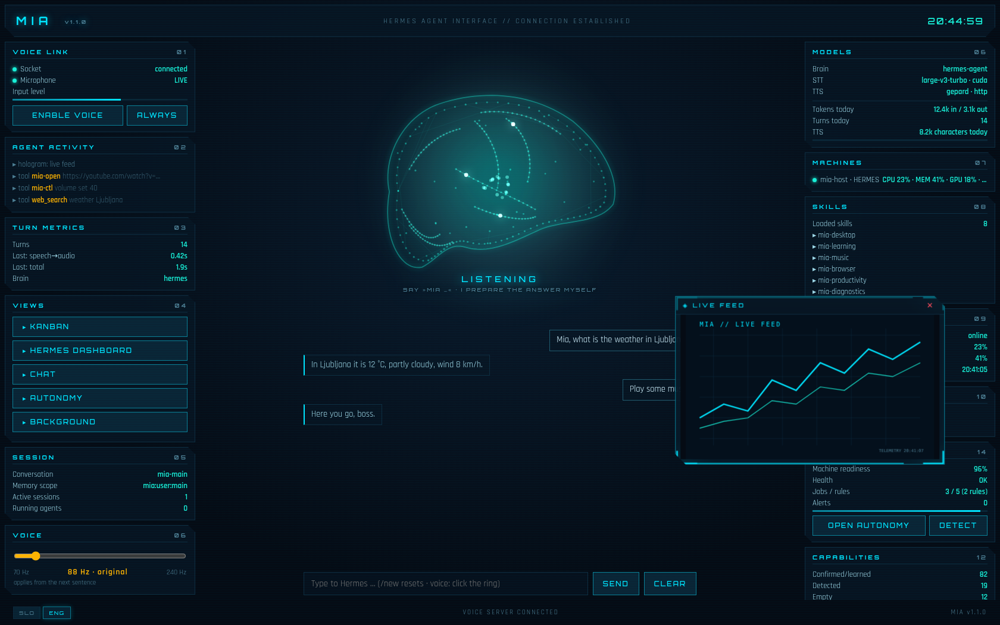

# Mia — your private voice assistant

**Mia lives on your machine. She listens, remembers, helps and speaks naturally
— in Slovenian or English.**

[](https://github.com/DanijelTech/Mia/actions/workflows/ci.yml)
[](LICENSE)
[](VERSION)
[](CONTRIBUTING.md)
[](ACCESSIBILITY.md)



> Slovenian: [README.sl.md](README.sl.md) · Technical docs: [docs/en/](docs/en/) · [docs/](docs/)

## Meet Mia

Mia is a local-first voice assistant and desktop companion for people who want
their computer to feel like a helpful presence, not another browser tab.

She listens for your voice, answers out loud, opens what you ask for, remembers
what matters and quietly handles the boring parts of your day. She runs on your
own hardware. There is no account, no subscription and no cloud in the default
setup.

Mia is her own project: a distinct assistant with her own HUD, memory,
autonomy and control layer. She is not a chat window with a microphone
attached. She is a small, private operating layer for your computer: a voice,
a memory, a pair of hands and a calm screen you can glance at.

## Why people choose Mia

- **Private by default.** Your voice, your memory and your machine data stay on
  your machine. Cloud models are optional, never required.
- **She actually does things.** Open apps, close windows, play music, find a
  file, set a reminder, check the disk, adjust the volume — not just talk about
  it.
- **She remembers you.** Preferences, routines, recipes and corrections become
  durable local memory. You do not repeat yourself every morning.
- **She learns your way of working.** When a procedure works, Mia keeps it.
  When you say “not like that”, she remembers the correction.
- **She speaks naturally.** Short spoken sentences, streamed as they are
  generated, with a voice you can tune. Slovenian and English are first-class.
- **She works offline.** Speech recognition, voice, memory and the agent loop
  can all run locally.
- **She is yours.** A HUD you can read at a glance, a CLI for power users, an
  HTTP API for integrations and a skill tree you can extend.

## What she can do

**Talk**

Continuous listening, a strict wake word, speaker recognition, natural
interruption, push-to-talk and a typed chat that shares the same conversation.
Ask a question, think out loud, or just say good morning.

**Act**

Open and close applications and windows, play music or video, search the web,
read and write files, take screenshots, use the clipboard, control volume and
brightness, lock or sleep the machine. Destructive actions ask first.

**Remember**

A local memory of episodes, preferences, habits, recipes and mistakes. Mia
brings the relevant part back before the next request instead of asking you
again.

**Automate**

Reminders, scheduled jobs, reactive rules (“when the disk is almost full…”),
multi-step plans with verification and rollback, health checks and a task
journal that survives restarts.

**Show**

A calm, readable HUD: voice state, live transcript, agent activity, memory,
capabilities, system health, automations and media panels. It is a dashboard,
not a toy — but it is allowed to look good.

**Protect**

A local access token, a strict allowlist for the agent bridge, secret
redaction, an audited control vocabulary and a policy that says which folders
and actions are allowed. See [SECURITY.md](SECURITY.md).

## A day with Mia

- **Morning.** “Mia, what is the weather and what do I have today?” She answers
  while the coffee is still brewing and puts the day’s tasks on the HUD.
- **Work.** “Mia, open the project folder and play something calm.” Windows
  open, music starts, the HUD shows what is running.
- **A correction.** “Not that playlist — the other one.” She switches, and the
  correction becomes part of how she works with you.
- **Evening.** “Mia, clean up the temp files and tell me if the disk is
  healthy.” A plan runs, verifies itself and reports back.
- **Quiet.** “Mia, good night.” Music stops, the volume drops, the screen locks.

## Start in three steps

```bash
git clone https://github.com/DanijelTech/Mia.git
cd Mia
sudo ./install.sh --yes --open
```

The installer prepares the local stack, creates the access token, starts the
service and opens the HUD already signed in. Then just say **“Mia, …”**.

Day to day:

```bash
./start-mia.sh          # start and open the HUD
./stop-mia.sh           # stop everything, free RAM/VRAM
./stop-mia.sh --status  # what is running, which ports
./update.sh             # pull the latest release and restart
```

Offline machine? `./build-package.sh` creates a portable archive with the
installer included.

## Requirements

- A computer that can run a local speech model and a local LLM (CPU is enough
  to start; a GPU makes conversation faster).
- Python 3.11+.
- A microphone and a modern browser on the same network.
- An open-source local agent runtime behind Mia — the installer and the
  [setup guide](docs/en/SETUP.md) connect it for you.
- Optional: a GPU, a second machine for speech, or a cloud voice if you choose.

The tested default is Linux with systemd. macOS works with launchd; the setup
guide documents the known platform notes. Windows can run the voice client and
the GPU worker.

## Documentation

| I want to… | Read |
|---|---|
| Install, configure voices and fix startup | [Setup](docs/en/SETUP.md) |
| Understand the voice loop, HUD and API | [Architecture](docs/en/ARCHITECTURE.md) |
| Use memory, habits, recipes and the skill tree | [Learning](docs/en/LEARNING.md) |
| Control windows, apps, files and power safely | [Control](docs/en/CONTROL.md) |
| Use plans, jobs, rules and health | [Autonomy](docs/en/AUTONOMY.md) |
| Calibrate the voice by distance | [Calibration](docs/en/CALIBRATION.md) |
| See what Mia can do on this machine | [Capabilities](docs/en/CAPABILITIES.md) |
| Fix a problem | [Troubleshooting](docs/en/TROUBLESHOOTING.md) |
| Cut a release | [Releasing](docs/en/RELEASING.md) |

## Community

Mia is built in the open. Whether you speak Slovenian, English or Python,
there is a useful place to help.

- **[Code of Conduct](CODE_OF_CONDUCT.md)** — the standard we hold each other to.
- **[Contributing](CONTRIBUTING.md)** — setup, tests, new commands, skills,
  HUD strings, translations and plugin tools.
- **[Support](SUPPORT.md)** — where to ask, what to include, response expectations.
- **[Governance](GOVERNANCE.md)** — roles, consensus, review and releases.
- **[Roadmap](ROADMAP.md)** — what is next and which tasks suit a first PR.
- **[Accessibility](ACCESSIBILITY.md)** — supported environments, known
  barriers and how to report one.
- **[Community playbook](docs/en/COMMUNITY.md)** — labels, GitHub settings and
  the launch checklist.
- **[Security](SECURITY.md)** — private vulnerability reporting and guarantees.

**Ways to help that matter right now**

- Test the installer on your distribution or desktop and report what worked.
- Translate one HUD string or one capability label (SLO ↔ ENG).
- Add a test for a command you actually use.
- Improve keyboard, screen-reader or contrast behaviour in the HUD.
- Share a 30-second demo or a screenshot of your setup in Discussions.
- Pick a **good first issue**; small and tested beats large and vague.

If Mia is useful to you, a star helps other people find her — but answering a
question or reviewing a pull request helps even more.

## Version

The current release is **1.1.0**. The version lives in [VERSION](VERSION), is
shown in the HUD and at `/api/version`, and every script answers `--version`.
History: [CHANGELOG.md](CHANGELOG.md). Release process:
[docs/en/RELEASING.md](docs/en/RELEASING.md).

## Credits & license

Mia is released under the [MIT License](LICENSE). She is an independent project;
third-party components and their licenses are listed in [CREDITS.md](CREDITS.md).
No endorsement or sponsorship by any third party is implied.
