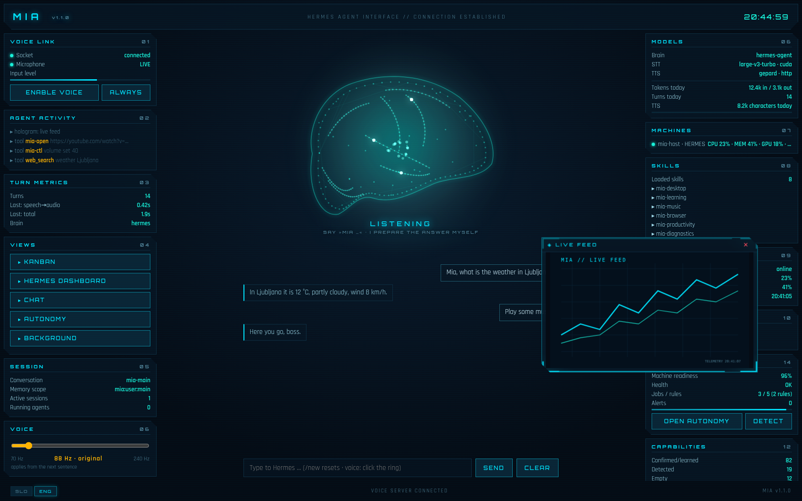

# Mia — tvoja zasebna glasovna asistentka

**Mia živi na tvojem računalniku. Posluša, si zapomni, pomaga in govori
naravno — v slovenščini ali angleščini.**

[](https://github.com/DanijelTech/Mia/actions/workflows/ci.yml)
[](LICENSE)
[](VERSION)
[](CONTRIBUTING.md)
[](ACCESSIBILITY.md)



> Angleško: [README.md](README.md) · Tehnična dokumentacija: [docs/](docs/) · [docs/en/](docs/en/)

## Spoznaj Mio

Mia je lokalna glasovna asistentka in spremljevalka na namizju za ljudi, ki
želijo, da je računalnik koristen sopotnik, ne pa še en zavihek v brskalniku.

Posluša tvoj glas, odgovarja naglas, odpre, kar prosiš, si zapomni, kar je
pomembno, in tiho opravi dolgočasne dele dneva. Teče na tvoji strojni opremi.
Ni računa, ni naročnine in v privzeti nastavitvi ni oblaka.

Mia je svoj projekt: samostojna asistentka z lastnim HUD-om, spominom,
samodejnostjo in plastjo nadzora. Ni klepetalno okno z mikrofonom. Je majhna,
zasebna plast med tabo in računalnikom: glas, spomin, roke in miren zaslon, na
katerega pogledaš.

## Zakaj ljudje izberejo Mio

- **Zasebnost po privzetem.** Tvoj glas, spomin in podatki o stroju ostanejo
  na stroju. Oblačni modeli so opcija, nikoli pogoj.
- **Res nekaj naredi.** Odpre aplikacije, zapre okna, predvaja glasbo, najde
  datoteko, nastavi opomnik, preveri disk, spremeni glasnost — ne le govori
  o tem.
- **Zapomni si te.** Nastavitve, rutine, recepti in popravki postanejo trajen
  lokalni spomin. Ni ti treba vsako jutro vsega ponavljati.
- **Uči se tvojega načina dela.** Ko postopek deluje, ga Mia obdrži. Ko rečeš
  »ne tako«, si zapomni popravek.
- **Govori naravno.** Kratke govorjene povedi se pretakajo sproti, glas pa
  prilagodiš. Slovenščina in angleščina sta prvorazredni.
- **Deluje brez povezave.** Prepoznava govora, glas, spomin in agentska zanka
  lahko tečejo lokalno.
- **Je tvoja.** HUD, ki ga prebereš na pogled, CLI za napredne uporabnike,
  HTTP API za integracije in drevo veščin, ki ga lahko razširiš.

## Kaj zna

**Govori**

Neprestano poslušanje, stroga budnica, prepoznava govorca, naravna prekinitev,
pritisni-in-govori ter tipkani klepet v istem pogovoru. Vprašaj, razmišljaj
naglas ali samo reci dobro jutro.

**Ukrepaj**

Odpira in zapira aplikacije ter okna, predvaja glasbo ali video, išče po spletu,
bere in piše datoteke, dela posnetke zaslona, uporablja odložišče, upravlja
glasnost in svetlost, zaklene ali uspava stroj. Nevarna dejanja najprej
vprašajo.

**Zapomni si**

Lokalni spomin epizod, nastavitev, navad, receptov in napak. Mia pred naslednjo
zahtevo vrne relevantni del, namesto da bi te spet spraševala.

**Avtomatiziraj**

Opomniki, časovna opravila, pravila na dogodke (»ko bo disk skoraj poln …«),
večkoračni načrti s preverjanjem in rollbackom, zdravstveni pregledi in dnevnik
nalog, ki preživi ponovni zagon.

**Pokaže**

Miren, berljiv HUD: stanje glasu, prepis v živo, aktivnost agenta, spomin,
zmogljivosti, zdravje sistema, avtomatizacije in medijske plošče. Je nadzorna
plošča, ne igrača — a se sme dobro videti.

**Varuje**

Lokalni dostopni žeton, strogi seznam dovoljenih povezav, prekrivanje skrivnosti,
revidiran besednjak nadzora in politika, ki določa, katere mape in dejanja so
dovoljeni. Glej [SECURITY.md](SECURITY.md).

## Dan z Mio

- **Jutro.** »Mia, kakšno je vreme in kaj imam danes?« Odgovori, medtem ko se
  še kuha kava, in na HUD dene današnje naloge.
- **Delo.** »Mia, odpri projekt in predvajaj nekaj mirnega.« Odprejo se okna,
  zaigra glasba, HUD pokaže, kaj teče.
- **Popravek.** »Ne ta seznam — drugi.« Preklopi, popravek pa postane del
  njenega načina dela s tabo.
- **Večer.** »Mia, počisti temp datoteke in povej, ali je disk zdrav.« Načrt se
  izvede, preveri in poroča.
- **Tišina.** »Mia, lahko noč.« Glasba se ustavi, glasnost pade, zaslon se
  zaklene.

## Začni v treh korakih

```bash
git clone https://github.com/DanijelTech/Mia.git
cd Mia
sudo ./install.sh --yes --open
```

Namestitvenik pripravi lokalni sklad, ustvari dostopni žeton, zažene storitev
in odpre HUD že prijavljen. Nato samo reci **»Mia, …«**.

Dan za dnem:

```bash
./start-mia.sh          # zaženi in odpri HUD
./stop-mia.sh           # ustavi vse, sprosti RAM/VRAM
./stop-mia.sh --status  # kaj teče, katera vrata
./update.sh             # potegni zadnjo izdajo in znova zaženi
```

Brez povezave? `./build-package.sh` ustvari prenosni arhiv z namestitvenikom.

## Zahteve

- Računalnik, ki lahko poganja lokalni govorni model in lokalni LLM (CPU je
  dovolj za začetek; GPU pospeši pogovor).
- Python 3.11+.
- Mikrofon in sodoben brskalnik v istem omrežju.
- Odprtokodni lokalni agentski pogon za Mio — namestitvenik in
  [vodnik za namestitev](docs/SETUP.md) ga povežeta.
- Neobvezno: GPU, drug stroj za govor ali oblačni glas, če se tako odločiš.

Preverjena privzeta nastavitev je Linux s systemd. macOS deluje z launchd;
vodnik dokumentira znane posebnosti posameznih platform. Windows lahko poganja
glasovnega odjemalca in GPU delavca.

## Dokumentacija

| Želim… | Preberi |
|---|---|
| Namestiti, nastaviti glasove in odpraviti zagon | [Namestitev](docs/SETUP.md) |
| Razumeti glasovno zanko, HUD in API | [Arhitektura](docs/ARCHITECTURE.md) |
| Uporabljati spomin, navade, recepte in drevo veščin | [Učenje](docs/LEARNING.md) |
| Varno upravljati okna, aplikacije, datoteke in napajanje | [Nadzor](docs/CONTROL.md) |
| Uporabljati načrte, opravila, pravila in zdravje | [Samodejnost](docs/AUTONOMY.md) |
| Kalibrirati glas po oddaljenosti | [Kalibracija](docs/CALIBRATION.md) |
| Videli, kaj Mia zmore na tem stroju | [Zmogljivosti](docs/CAPABILITIES.md) |
| Rešiti težavo | [Odpravljanje težav](docs/TROUBLESHOOTING.md) |
| Izdati različico | [Izdajanje](docs/RELEASING.md) |

## Skupnost

Mia se razvija odprto. Ne glede na to, ali govoriš slovensko, angleško ali
Python, obstaja koristen način za pomoč.

- **[Kodeks ravnanja](CODE_OF_CONDUCT.md)** — standard, ki ga spoštujemo.
- **[Prispevanje](CONTRIBUTING.md)** — namestitev, testi, novi ukazi, veščine,
  HUD nizi, prevodi in orodja vtičnikov.
- **[Podpora](SUPPORT.md)** — kje vprašati, kaj priložiti, pričakovanja.
- **[Upravljanje](GOVERNANCE.md)** — vloge, konsenz, pregled in izdaje.
- **[Načrt](ROADMAP.md)** — kaj je naslednje in katere naloge so za prvi PR.
- **[Dostopnost](ACCESSIBILITY.md)** — podprta okolja, znane ovire in prijava.
- **[Priročnik za skupnost](docs/COMMUNITY.md)** — oznake, nastavitve GitHuba in
  kontrolni seznam ob objavi.
- **[Varnost](SECURITY.md)** — zasebna prijava ranljivosti in garancije.

**Kako lahko pomagaš zdaj**

- Preizkusi namestitvenik na svoji distribuciji ali namizju in sporoči, kaj
  deluje.
- Prevedi en HUD niz ali eno oznako zmogljivosti (SLO ↔ ENG).
- Dodaj test za ukaz, ki ga res uporabljaš.
- Izboljšaj tipkovnico, bralnik zaslona ali kontrast v HUD-u.
- Deli 30-sekundni demo ali posnetek svoje postavitve v Discussions.
- Izberi **good first issue**; majhno in testirano je bolje kot veliko in
  nejasno.

Če ti Mia koristi, zvezdica pomaga drugim, da jo najdejo — a odgovor na
vprašanje ali pregled PR-ja pomaga še bolj.

## Različica

Trenutna izdaja je **1.1.0**. Različica je v [VERSION](VERSION), prikaže se v
HUD-u in na `/api/version`, vsaka skripta pa odgovori na `--version`.
Zgodovina: [CHANGELOG.md](CHANGELOG.md). Postopek izdaje:
[docs/RELEASING.md](docs/RELEASING.md).

## Zasluge in licenca

Mia je izdana pod [licenco MIT](LICENSE). Je neodvisen projekt; tretje
komponente in njihove licence so naštete v [CREDITS.md](CREDITS.md).
Nobena omemba ne pomeni odobritve ali sponzorstva.
